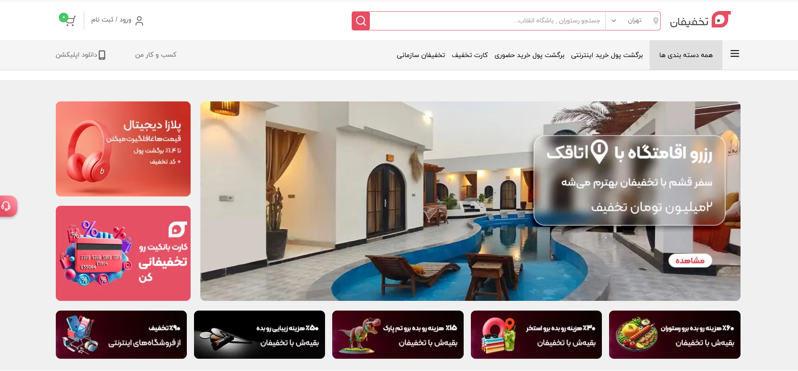
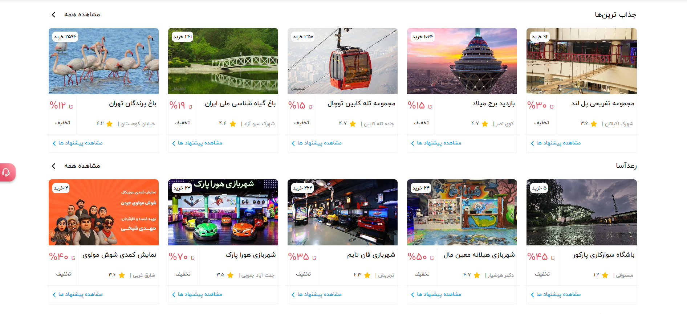
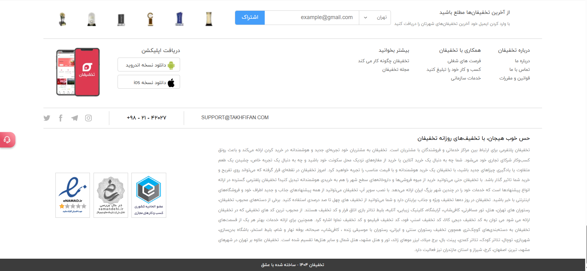
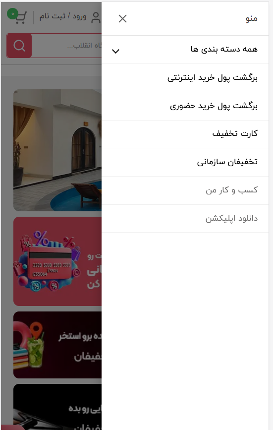
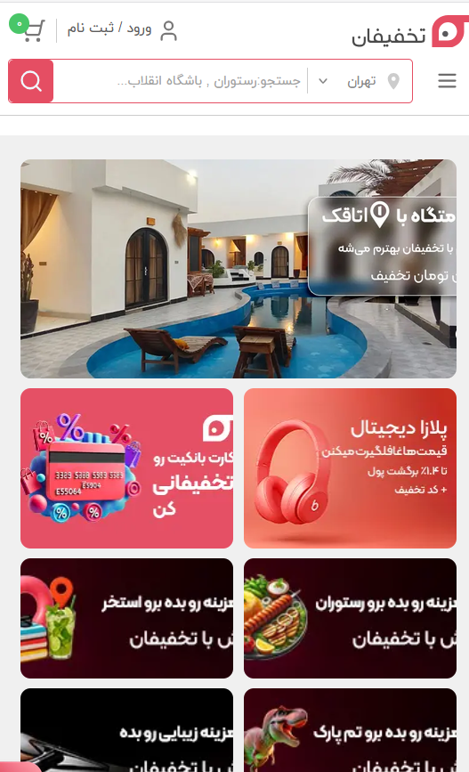

# 🏷️ Takhfifan UI Project

A clone of the homepage of **Takhfifan**, an Iranian discount and deals platform, built with HTML, CSS, and vanilla JavaScript using a Persian right-to-left (RTL) layout.

## 📖 Description

Takhfifan is a front-end practice project focused on building a complete, responsive e-commerce landing page from scratch. The desktop version was built first, then adapted for tablet and mobile screens using media queries, including a slide-in sidebar menu for smaller screens.

The project concentrates on the visual interface. Elements such as the search box, login, shopping cart, and newsletter form are UI mockups only and have no backend functionality.

> This project is built purely for practice and portfolio purposes and has no affiliation with Takhfifan.

## ✨ Features

- Persian RTL layout
- Responsive design for desktop, tablet, and mobile
- Header with logo, city selector, search box, login link, and cart badge
- Desktop navigation bar with a category dropdown and a nested submenu (opens on hover)
- Mobile and tablet hamburger menu that opens a white sidebar from the right
- Dark overlay behind the sidebar, closes on overlay click, close button, or the `Esc` key
- Accordion-style categories inside the mobile sidebar
- Banner gallery built with CSS Grid
- Card sections for deals, each with purchase count, rating, discount percentage, and offers link
- Cashback section with partner store cards
- Footer with newsletter form, link columns, app download buttons, social icons, and trust badges
- Floating support button
- Custom local font (IRANYekan)

## 🛠️ Technologies

- HTML5
- CSS3
- Flexbox
- CSS Grid
- Media Queries
- CSS Custom Properties (variables)
- `@font-face` for local fonts
- Vanilla JavaScript (ES6)
- Inline SVG icons

> No frameworks or external libraries were used. The icons are inline SVG code, so no icon library is loaded.

🔗 **Live Demo:** [View live project](https://anahita-valipour.github.io/takhfifan-website)

---

## 📸 Screenshots

### 🖥️ Desktop

<table>
  <tr>
    <td align="center" width="33%">
      
      <br />
      <sub><b>Desktop – Top Section</b><br />Header, navigation bar, and banner gallery</sub>
    </td>
    <td align="center" width="33%">
      
      <br />
      <sub><b>Desktop – Middle Section</b><br />Deal cards in a responsive grid</sub>
    </td>
    <td align="center" width="33%">
      
      <br />
      <sub><b>Desktop – Footer Section</b><br />Newsletter, links, app buttons, and badges</sub>
    </td>
  </tr>
</table>

### 📱 Mobile

<table>
  <tr>
    <td align="center" width="50%">
      
      <br />
      <sub><b>Mobile – Default State</b><br />Sidebar closed, hamburger next to the search box</sub>
    </td>
    <td align="center" width="50%">
      
      <br />
      <sub><b>Mobile – Sidebar Open</b><br />White sidebar with all menu options over a dark overlay</sub>
    </td>
  </tr>
</table>

---

## 📱 Responsive Design

The layout was designed desktop-first and adapted with `max-width` media queries.

| Screen size                        | Behavior                                                                                                                                                                                                                                     |
| :--------------------------------- | :------------------------------------------------------------------------------------------------------------------------------------------------------------------------------------------------------------------------------------------- |
| **Desktop (above 768px)**          | Full header with the logo and search box on one row and the navigation bar below it. The category dropdown opens on hover. "My business" and "Download app" sit on the left side of the navigation row.                                      |
| **Around 1024px (960px – 1024px)** | Same desktop header with slightly larger spacing between menu items so every option stays on one row.                                                                                                                                        |
| **Tablet (768px and below)**       | The hamburger menu replaces the navigation bar. The header becomes two rows: logo and account on the first row, hamburger and search box on the second. All menu options, including "My business" and "Download app", move into the sidebar. |
| **Mobile (640px and below)**       | Same header as the tablet layout, with more changes: two-column banner grid, stacked cashback section, two-column partner cards, and a stacked footer.                                                                                       |

**Responsive navigation:** below 768px, the sidebar slides in from the right with a CSS transition (`transform`). A dark overlay covers the page, and background scrolling is disabled while the menu is open.

Breakpoints used in the stylesheet:

```text
80em   (1280px)   – empty placeholder
64em   (1024px)   – empty placeholder
60em–64em         – menu spacing adjustment (960px – 1024px)
48em   (768px)    – tablet layout and hamburger header
40em   (640px)    – small tablet adjustments
639.98px          – mobile layout for the page body
30em   (480px)    – small mobile adjustments
```

---

## 🎨 Fonts & Styling

**Font:** IRANYekan, hosted locally and loaded with `@font-face` in four formats (`.eot`, `.woff2`, `.woff`, `.ttf`), with `sans-serif` as a fallback.

**Font weights used:** 300 (body text and headings), 400, and 500.

**Font sizes:** defined as CSS custom properties from `--fs-11` to `--fs-40` using `rem` units.

**Color palette:**

| Color      | Hex                   | Usage                               |
| :--------- | :-------------------- | :---------------------------------- |
| Brand red  | `#e54e63`             | Search button, discount percentages |
| Purple     | `#8754af`             | Cashback section                    |
| Blue       | `#039be5`             | "View offers" links                 |
| Light blue | `#459efa`             | Newsletter subscribe button         |
| Green      | `#49c668`             | Cart badge                          |
| Gold       | `#FFC107`             | Rating stars                        |
| Dark gray  | `#3c3c3c`             | Main text                           |
| Light gray | `#f0f0f0` / `#f5f5f5` | Section and header backgrounds      |

**Main techniques:**

- CSS Grid for the banner gallery, deal cards, cashback cards, and footer
- Flexbox for the header, navigation, cards, and footer rows
- `position: absolute` and `position: fixed` for dropdowns, the sidebar, the overlay, and the floating support button
- `display: contents` to rearrange header items on tablet and mobile without changing the HTML
- `aspect-ratio` and `object-fit` for consistent image sizing
- Direction set to RTL on the `body`

---

## ⚙️ JavaScript Functionality

All JavaScript is in `script.js` and is written in vanilla JavaScript with no libraries. It only handles the responsive menu:

- **Sidebar open and close:** the hamburger button toggles the `menu-open` class on `<body>`, and CSS handles the animation.
- **Multiple ways to close:** close button, click on the overlay, or the `Esc` key.
- **`matchMedia`:** detects the mobile and tablet breakpoint (`max-width: 768px`). When the window grows past it, the menu closes and any open submenus reset.
- **Accordion categories:** inside the sidebar, "All categories" and its nested "Fun & Sports" item expand and collapse on click.
- **Accessibility:** `aria-expanded` and `aria-controls` on the hamburger button, `aria-label` on the buttons, and focus management that moves focus to the close button when the menu opens and back to the hamburger when it closes.

---

## 📁 Project Structure

```text
takhfifan-website/
├── font/
│   └── iranyekan/
│       ├── IRANYekanWeb.eot
│       ├── IRANYekanWeb.ttf
│       ├── IRANYekanWeb.woff
│       └── IRANYekanWeb.woff2
├── images/
├── screenshots/
│   ├── desktop-top.png
│   ├── desktop-middle.png
│   ├── desktop-footer.png
│   ├── mobile-default.png
│   └── mobile-sidebar-open.png
├── index.html
├── style.css
├── script.js
└── README.md
```

## 🚀 How to Run

Clone the repository and open `index.html` in your browser. No installation required.

```bash
git clone https://github.com/YOUR-USERNAME/takhfifan-website.git
```

Or open the project in VS Code and run it with the **Live Server** extension.

## 🎯 Learning Goals

This project was built to practice and strengthen:

- Structuring pages with HTML5
- Building layouts with Flexbox and CSS Grid
- Responsive web design with a desktop-first approach
- Using media queries for tablet and mobile layouts
- Positioning elements with the `position` property
- Building dropdown menus, hover effects, and CSS transitions
- Using local fonts with `@font-face` and CSS custom properties
- Working with a right-to-left (RTL) layout
- JavaScript DOM manipulation and event handling
- Building an interactive sidebar menu with `matchMedia`, focus management, and ARIA attributes

---

## 👩‍💻 Author

**[Your Name]**
🔗 [GitHub](https://github.com/anahita-valipour)

---

## 📄 License

This project was built for educational and portfolio purposes only.
